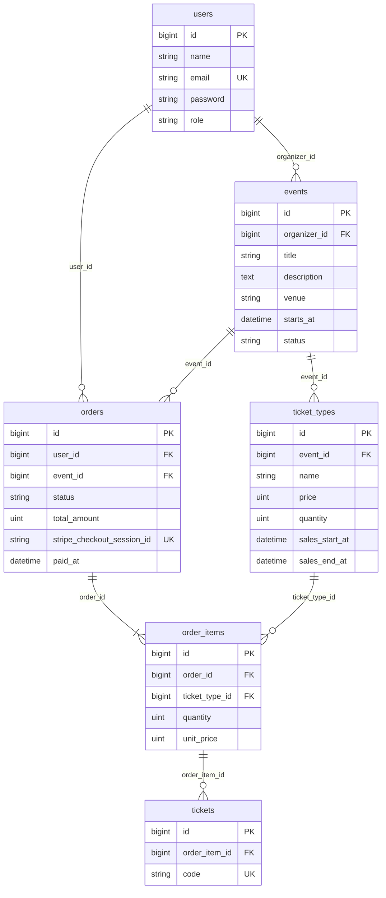

# データベース設計

## ER 図



## テーブル定義

文字列系の列（`role`、`status`）は DB の enum 型ではなく `string` で持つ。値は PHP の Enum（`UserRole`、`EventStatus`、`OrderStatus`）でキャストする。値の追加が楽なため。

### users（Laravel 標準のテーブルに `role` を追加）

| カラム | 型 | 制約 | 説明 |
|-|-|-|-|
| id | bigint unsigned | PK | |
| name | string(255) | NOT NULL | |
| email | string(255) | UNIQUE, NOT NULL | |
| email_verified_at | timestamp | NULL | 標準のまま |
| password | string(255) | NOT NULL | |
| role | string(20) | NOT NULL, default `customer`, INDEX | `customer` / `organizer` / `admin` |
| remember_token, timestamps | | | 標準のまま |

### events

| カラム | 型 | 制約 | 説明 |
|-|-|-|-|
| id | bigint unsigned | PK | |
| organizer_id | bigint unsigned | FK → users.id, NOT NULL, INDEX | 主催者 |
| title | string(255) | NOT NULL | |
| description | text | NULL | |
| venue | string(255) | NOT NULL | 会場 |
| starts_at | datetime | NOT NULL | 開催日時 |
| status | string(20) | NOT NULL, default `draft` | `draft` / `published` |
| timestamps | | | |

インデックス: `(status, starts_at)`（一覧表示用）、`organizer_id`（ダッシュボード用）。

### ticket_types（券種）

| カラム | 型 | 制約 | 説明 |
|-|-|-|-|
| id | bigint unsigned | PK | |
| event_id | bigint unsigned | FK → events.id, NOT NULL, INDEX | |
| name | string(100) | NOT NULL | 例: 一般、学生 |
| price | unsigned integer | NOT NULL | 円。0 円（無料）を許可 |
| quantity | unsigned integer | NOT NULL | 定員（販売する総枚数） |
| sales_start_at | datetime | NOT NULL | 販売開始 |
| sales_end_at | datetime | NOT NULL | 販売終了。開始より後であることはバリデーションで確認 |
| timestamps | | | |

### orders

| カラム | 型 | 制約 | 説明 |
|-|-|-|-|
| id | bigint unsigned | PK | |
| user_id | bigint unsigned | FK → users.id, NOT NULL | 注文者 |
| event_id | bigint unsigned | FK → events.id, NOT NULL | 1注文は1イベントのみ。主催者の注文一覧（C16）を引きやすくする |
| status | string(20) | NOT NULL, default `pending` | `pending`（支払い待ち）/ `paid`（支払い済み） |
| total_amount | unsigned integer | NOT NULL | 合計金額（円）。注文作成時に明細から計算して保存。Webhook で Stripe の金額と照合する |
| stripe_checkout_session_id | string(255) | UNIQUE, NULL | Checkout Session 作成前は NULL。UNIQUE で Webhook の二重処理を防ぐ |
| paid_at | datetime | NULL | 支払い確定日時 |
| timestamps | | | |

インデックス: `(user_id, created_at)`（マイページ用）、`(event_id, status)`（売上集計用）。

### order_items（明細）

| カラム | 型 | 制約 | 説明 |
|-|-|-|-|
| id | bigint unsigned | PK | |
| order_id | bigint unsigned | FK → orders.id, NOT NULL | |
| ticket_type_id | bigint unsigned | FK → ticket_types.id, NOT NULL | |
| quantity | unsigned smallInteger | NOT NULL | 枚数（1以上） |
| unit_price | unsigned integer | NOT NULL | 注文時点の単価（円）。後で券種の価格が変わっても動かない |
| timestamps | | | |

`(order_id, ticket_type_id)` に UNIQUE を付け、同じ券種の明細が2行できないようにする。小計は `quantity * unit_price` で求めるので、列は持たない。

### tickets

| カラム | 型 | 制約 | 説明 |
|-|-|-|-|
| id | bigint unsigned | PK | |
| order_item_id | bigint unsigned | FK → order_items.id, NOT NULL, INDEX | どの明細の何枚目か |
| code | string(26) | UNIQUE, NOT NULL | 1枚ごとの固有コード。ULID（`Str::ulid()`）で生成 |
| timestamps | | | |

支払い確定時に、明細の `quantity` 枚ぶん行を作る。

## 外部キーの削除時の動き

| 外部キー | 動き | 理由 |
|-|-|-|
| events.organizer_id → users | **restrict** | 主催者を消すとイベントが孤児になる。ユーザー削除はコアの範囲外 |
| orders.user_id → users | **restrict** | 注文は売上の記録なので、ユーザーと一緒に消さない |
| ticket_types.event_id → events | **cascade** | 券種はイベントの一部。ただし注文がある券種は下の restrict で止まる |
| orders.event_id → events | **restrict** | 注文があるイベントは削除できない |
| order_items.ticket_type_id → ticket_types | **restrict** | 注文済みの券種は削除できない |
| order_items.order_id → orders | **cascade** | 明細は注文の一部 |
| tickets.order_item_id → order_items | **cascade** | チケットは明細の一部 |

注文のあるイベントや券種は DB が削除を止める。画面側でも先に Policy か事前チェックで弾き、「注文があるため削除できません。非公開（下書き）に戻してください」と表示する。DB のエラーをそのまま出さないため。

## 残り枚数の計算方法

残り枚数は列に持たず、そのつど計算する。列で持つと更新漏れで数が狂うため。

```
残り枚数 = ticket_types.quantity
         − SUM(order_items.quantity)
           ※ 対象は、その券種の明細のうち、親の orders.status が pending または paid のもの
```

- **`pending` も差し引く。** 支払い待ちの人が決済している間に、同じ枚数が別の人へ売れてしまうのを防ぐため。
- **`paid` になっても二重に引かない。** 同じ明細が `pending` から `paid` に変わるだけで、明細の行は増えないため。
- **`tickets` の行数は数えない。** 発行は支払い確定後なので、`pending` の分が漏れる。

### 購入時のチェック（C9）

注文を作る前に、次の3つを確認する。1つでも満たさなければエラーを表示し、注文は作らない。

1. 現在時刻が `sales_start_at` 以上、`sales_end_at` 以下である。
2. 選んだ枚数が残り枚数以下である。
3. イベントが `published` である。

### 実装の目安

`TicketType` モデルにアクセサ（`remaining`）を持たせる。一覧や詳細で複数の券種を表示するときは、N+1 を避けるために `withSum` で集計を一括取得する。

```php
TicketType::query()
    ->withSum(['orderItems as sold_quantity' => fn ($query) => $query
        ->whereHas('order', fn ($q) => $q->whereIn('status', ['pending', 'paid'])),
    ], 'quantity');
```

残り枚数は `quantity - sold_quantity` で求める。

### 既知の制約

- **`pending` の期限切れは扱わない。** 放置された `pending` が枚数を握り続ける。必要になったら `expired` 状態と `expires_at` を足し、期限切れを集計から外す。
- **同時購入の競合は扱わない。** 2人が同時に最後の1枚を買うと、チェックをすり抜ける可能性がある。トランザクションと行ロックによる対策は拡張 E2 で扱う。
