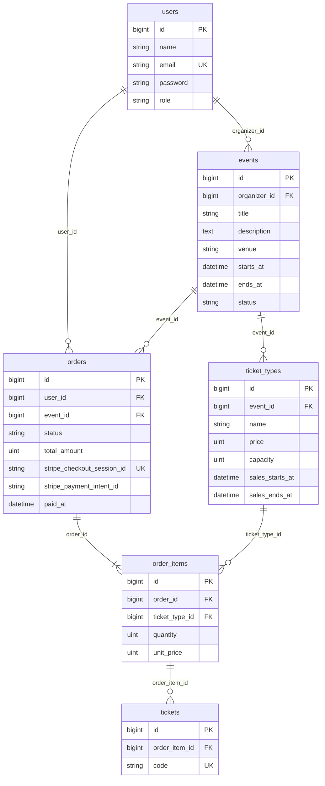

# データベース設計

## ER 図



## テーブル定義

文字列系の列（`role`、`status`）は DB の enum 型ではなく `string` で持つ。値は PHP の Enum（`UserRole`、`EventStatus`、`OrderStatus`）でキャストする。値の追加が楽なため。

### users（Laravel 標準のテーブルに `role` を追加）

| カラム | 型 | 制約 | 説明 |
|-|-|-|-|
| id | bigint unsigned | PK | |
| name | string(255) | NOT NULL | |
| email | string(255) | UNIQUE, NOT NULL | |
| email_verified_at | timestamp | NULL | 標準のまま |
| password | string(255) | NOT NULL | |
| role | string(20) | NOT NULL, default `customer`, INDEX | `customer` / `organizer` / `admin` |
| remember_token, timestamps | | | 標準のまま |

### events

| カラム | 型 | 制約 | 説明 |
|-|-|-|-|
| id | bigint unsigned | PK | |
| organizer_id | bigint unsigned | FK → users.id, NOT NULL, INDEX | 主催者 |
| title | string(255) | NOT NULL | |
| description | text | NULL | |
| venue | string(255) | NOT NULL | 会場 |
| starts_at | datetime | NOT NULL | 開催日時 |
| ends_at | datetime | NOT NULL | 終了日時。`starts_at` より後 |
| status | string(20) | NOT NULL, default `draft` | `draft`（下書き）/ `published`（公開中）/ `unpublished`（管理者が非公開にした。主催者は再公開できない） |
| timestamps | | | |

インデックス: `(status, starts_at)`（一覧表示用）、`organizer_id`（ダッシュボード用）。

### ticket_types（券種）

| カラム | 型 | 制約 | 説明 |
|-|-|-|-|
| id | bigint unsigned | PK | |
| event_id | bigint unsigned | FK → events.id, NOT NULL, INDEX | |
| name | string(100) | NOT NULL | 例: 一般、学生 |
| price | unsigned integer | NOT NULL | 円。0 円（無料）を許可 |
| capacity | unsigned integer | NOT NULL | 定員（販売する総枚数）。1以上。`order_items.quantity`（購入枚数）と区別するため `capacity` とする |
| sales_starts_at | datetime | NOT NULL | 販売開始 |
| sales_ends_at | datetime | NOT NULL | 販売終了。開始より後であることはバリデーションで確認 |

画面の入力は、券種名が50文字以内、価格が 0〜10,000,000 の整数、定員が 1〜100,000 の整数。券種が1つも無いイベントは公開できない。公開中のイベントの最後の券種は削除できない。券種を編集するとき、定員は「支払い済み＋確保中（`PENDING_MINUTES` 分以内の支払い待ち）の枚数」（`TicketType::reservedQuantity()`）より少なくできない。この下限は画面から書き換えられないよう、保存のたびにサーバー側で DB から求める。
| timestamps | | | |

### orders

| カラム | 型 | 制約 | 説明 |
|-|-|-|-|
| id | bigint unsigned | PK | |
| user_id | bigint unsigned | FK → users.id, NOT NULL | 注文者 |
| event_id | bigint unsigned | FK → events.id, NOT NULL | 1注文は1イベントのみ。主催者の注文一覧（C16）を引きやすくする |
| status | string(20) | NOT NULL, default `pending` | `pending`（支払い待ち）/ `paid`（支払い済み）/ `cancelled`（キャンセル）/ `refunded`（返金済み）。残り枚数の計算に含めるのは `pending` と `paid` だけ |
| total_amount | unsigned integer | NOT NULL | 合計金額（円）。注文作成時に明細から計算して保存。Webhook で Stripe の金額と照合する |
| stripe_checkout_session_id | string(255) | UNIQUE, NULL | Checkout Session 作成前は NULL。UNIQUE で Webhook の二重処理を防ぐ |
| stripe_payment_intent_id | string(255) | NULL | 支払い確定時に保存する PaymentIntent の ID。返金（拡張 E3）で使う。0円の注文は NULL |
| paid_at | datetime | NULL | 支払い確定日時 |
| timestamps | | | |

インデックス: `(user_id, created_at)`（マイページ用）、`(event_id, status)`（売上集計用）。

### order_items（明細）

| カラム | 型 | 制約 | 説明 |
|-|-|-|-|
| id | bigint unsigned | PK | |
| order_id | bigint unsigned | FK → orders.id, NOT NULL | |
| ticket_type_id | bigint unsigned | FK → ticket_types.id, NOT NULL | |
| quantity | unsigned smallInteger | NOT NULL | 枚数（1以上） |
| unit_price | unsigned integer | NOT NULL | 注文時点の単価（円）。後で券種の価格が変わっても動かない |
| timestamps | | | |

`(order_id, ticket_type_id)` に UNIQUE を付け、同じ券種の明細が2行できないようにする。小計は `quantity * unit_price` で求めるので、列は持たない。

### tickets

| カラム | 型 | 制約 | 説明 |
|-|-|-|-|
| id | bigint unsigned | PK | |
| order_item_id | bigint unsigned | FK → order_items.id, NOT NULL, INDEX | どの明細の何枚目か |
| code | string(26) | UNIQUE, NOT NULL | 1枚ごとの固有コード。ULID（`Str::ulid()`）で生成 |
| timestamps | | | |

支払い確定時に、明細の `quantity` 枚ぶん行を作る（`OrderService::markAsPaid()`）。`status` が `pending` の行だけを更新する条件付き UPDATE が成功した1回だけ作るので、Webhook と完了ページが同時に来てもチケットは二重にならない。

## 外部キーの削除時の動き

| 外部キー | 動き | 理由 |
|-|-|-|
| events.organizer_id → users | **restrict** | 主催者を消すとイベントが孤児になる。ユーザー削除はコアの範囲外 |
| orders.user_id → users | **restrict** | 注文は売上の記録なので、ユーザーと一緒に消さない |
| ticket_types.event_id → events | **cascade** | 券種はイベントの一部。ただし注文がある券種は下の restrict で止まる |
| orders.event_id → events | **restrict** | 注文があるイベントは削除できない |
| order_items.ticket_type_id → ticket_types | **restrict** | 注文済みの券種は削除できない |
| order_items.order_id → orders | **cascade** | 明細は注文の一部 |
| tickets.order_item_id → order_items | **cascade** | チケットは明細の一部 |

注文のあるイベントや券種は DB が削除を止める。画面側でも先に Policy か事前チェックで弾き、「注文があるため削除できません。非公開（下書き）に戻してください」と表示する。DB のエラーをそのまま出さないため。

## 残り枚数の計算方法

残り枚数は列に持たず、そのつど計算する。列で持つと更新漏れで数が狂うため。

```
残り枚数 = ticket_types.capacity
         − SUM(order_items.quantity)
           ※ 対象は、その券種の明細のうち、親の orders が次のどちらかのもの
             ・status が paid
             ・status が pending で、created_at が PENDING_MINUTES（35）分以内
```

- **`pending` は35分だけ差し引く。** 支払い待ちの人が決済している間に、同じ枚数が別の人へ売れてしまうのを防ぐため。35分を過ぎた `pending` は、放置されたものとして数えない（境界の「ちょうど35分前」は数える）。時間は `OrderService::PENDING_MINUTES` で持つ。Stripe Checkout Session の有効期限（`expires_at`、`OrderService::CHECKOUT_MINUTES`）は30分で、押さえの時間より短くする。決済ページで払える間は、必ず枠が残っているようにするため（Stripe は30分未満を指定できない）。
- **押さえが切れた後に支払いが確定するとき**（Webhook の遅れなど）は、`markAsPaid` が券種の行をロックして定員を確認し直す。すでに定員を超えるなら、チケットを発行せず、注文は `pending` のまま `Log::error` に「返金が必要」と残す（返金は運用で行う）。
- **`cancelled` / `refunded` は数えない。**
- **残り枚数は 0 未満にしない。** 同時購入の競合で売りすぎた場合も、画面には負の数を出さない。
- **`paid` になっても二重に引かない。** 同じ明細が `pending` から `paid` に変わるだけで、明細の行は増えないため。
- **`tickets` の行数は数えない。** 発行は支払い確定後なので、`pending` の分が漏れる。

### 同時購入と買い占めの守り

- **行ロック。** `createOrder` は、トランザクションの最初に、買う券種の行を `lockForUpdate()`（id 順）でロックし、そのあとで残り枚数を数える。同時に買う人は、ロックが外れるまで待ち、数え直した枚数で成否が決まる。定員を変える券種の編集（`saveTicketType`）も、同じ行ロックの中で下限を確認する。
- **1人あたりの上限。** 1つのイベントで、1人が持てるのは合計 `OrderService::MAX_TICKETS_PER_EVENT`（10）枚まで（支払い済み＋枠を押さえている支払い待ち）。無料券にも適用する。
- **古い支払い待ちの取り消し。** 「支払いへ進む」を押すと、同じ人のこのイベントの支払い待ちの注文を先に取り消す（Stripe の決済ページを失効させてから）。取り消せないとき（支払いが済んだ直後など）は購入を止める。
- **回数制限。** 「支払いへ進む」は、1人が1分間に5回まで。

### 購入時のチェック（C9）

注文を作る前に、次を確認する。1つでも満たさなければ `PurchaseException`（メッセージは画面にそのまま出せる日本語）を投げ、注文は作らない。確認と作成は `OrderService::createOrder()` が1つのトランザクションで行う（全か無か）。

1. イベントが `published` である。
2. 券種ごとの枚数が 1 以上 `OrderService::MAX_QUANTITY`（10）以下の整数である。枚数が 0 の券種は「買わない」として無視する。画面のセレクトで絞るだけでなく、Livewire のプロパティは直接書き換えられるため、ここでも必ず確認する。
3. 券種がそのイベントのものである（別のイベントの券種や存在しない ID は不可）。
4. 現在時刻が `sales_starts_at` 以上、`sales_ends_at` 以下である（`TicketType::isOnSale()`）。
5. 選んだ枚数が残り枚数以下である（`TicketType::remaining()`）。
6. この人がこのイベントで持つ枚数（支払い済み＋確保中）と合わせて、`MAX_TICKETS_PER_EVENT`（10）枚以内である。

金額は引数で受け取らず、券種の `price` から計算する。明細の `unit_price` には、注文時点の `price` を保存する。

### 実装の目安

`TicketType::remaining()` が残り枚数を返す。一覧や詳細で複数の券種を表示するときは、N+1 を避けるために、スコープ `withReservedQuantity()`（`withSum` で `reserved_quantity` を一括取得）を使う。読み込み済みなら `remaining()` は追加の問い合わせをしない。

```php
$event->ticketTypes()->withReservedQuantity()->get();
```

残り枚数は `capacity - reserved_quantity`（0 未満は 0）で求める。

### 既知の制約

- **期限切れの `pending` は、状態を変えずに集計から外すだけ。** 35分を過ぎた `pending` は、決済ページ（Checkout Session）の期限が切れたときの Webhook `checkout.session.expired` で `cancelled` になる。Webhook が届かなかった分は、同じ人の次の購入のときに `OrderService::abandonPendingOrders()` が取り消す（Stripe の失効の API が失敗したら、Session の状態を取得し、失効済みなら取り消す。支払い済みなら確定する。後払い型で入金待ちなら、そのまま残す）。`cancelled` などへ変える後始末が必要になったら、スケジュールで処理する。
- **同時購入の競合は扱わない。** 2人が同時に最後の1枚を買うと、チェックをすり抜ける可能性がある。トランザクションと行ロックによる対策は拡張 E2 で扱う。
